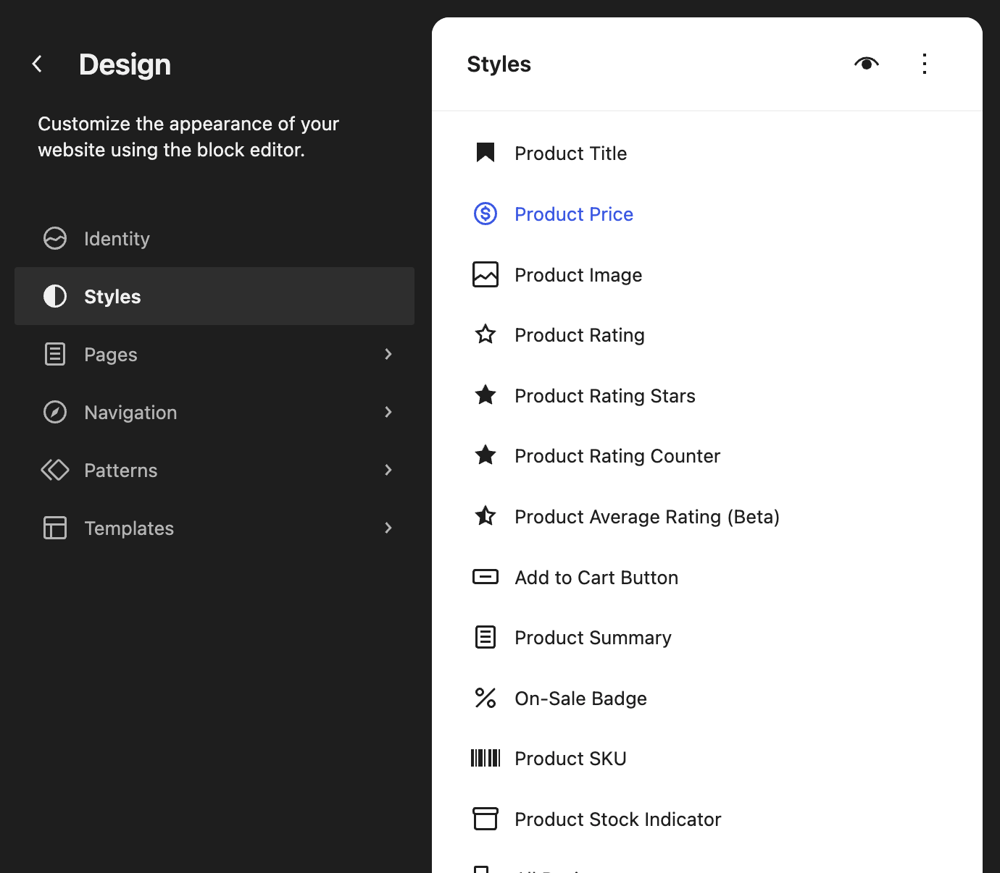
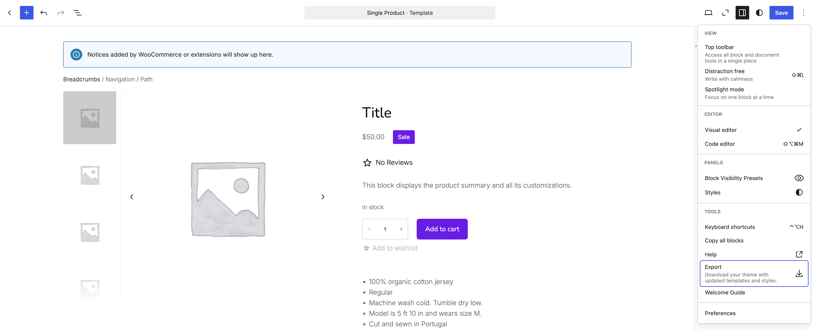

# Global styles for WooCommerce

Global styles let a Block theme define typography, color, and spacing once in `theme.json`, then apply those choices everywhere a matching Block appears. WooCommerce Blocks are a part of this system, but there's differing adoption between them. This means a few product elements render through core WordPress Blocks, which changes the selector you target.

This section will cover how global styles apply across a WooCommerce store through `theme.json`, starting with applying colors and typography. From there, it moves into using Block style variations, registering your own style variations, customizing the appearance in the Site Editor, and exporting a finished style configuration.

## Requirements

Before you begin, make sure you have the following in place:

- **A Block theme.** Classic themes can also use `theme.json`, but this guide's Site Editor workflow and WooCommerce Block-template examples assume a Block theme.
- **Familiarity with `theme.json`.** The guidance builds directly on the `theme.json` styles and settings structure rather than introducing it from scratch.

## How global styles apply to WooCommerce Blocks

You can target registered Blocks from `theme.json` under `styles.blocks`. A Block's registered supports tell you which editor controls and standard style handling it explicitly exposes. [WooCommerce Blocks](https://developer.woocommerce.com/docs/block-development/reference/block-references/) offer varied support, so confirm both the support and the selector used for editor and front-end output.

For example, `woocommerce/product-price` supports color, typography, and spacing. The `woocommerce/product-collection` wrapper supports alignment and layout, while its descendant Blocks provide the styling controls for product cards. As such, confirm what each Block supports before writing style rules.

Also, some elements are actually core WordPress Blocks configured for a product context rather than dedicated WooCommerce Blocks:

- **Product titles** render through `core/post-title` in WooCommerce's current Single Product template.
- **Product summaries** render through `core/post-excerpt` in that template.
- **Product categories and tags** render through `core/post-terms`, configured with WooCommerce-specific taxonomy variations rather than a dedicated WooCommerce Block.
- **Product grids created with Product Collection** render each item's title through `core/post-title` when the template follows WooCommerce's own patterns.

WooCommerce builds its templates by mixing its own and core WordPress Blocks wherever the latter already does the job. The reliable way to confirm what you're styling is to inspect the template's Block markup through the **Code editor** in the Site Editor. Use the WordPress REST API's Block Types endpoint separately to inspect a registered Block's supports, selectors, styles, and variations.

## Using `theme.json` to define WooCommerce-specific styles

Most of your styling work happens within `theme.json`. The next three sections cover typography for text-based product details, setting colors for on-screen elements, and spacing for product grids.

### Styling typography for product titles, prices, and descriptions

`woocommerce/product-price` and `woocommerce/product-summary` both offer typography support, including font size, line height, font family, font weight, and letter spacing. You can style them directly when those Blocks appear in your template:

```json
{
  "version": 3,
  "styles": {
    "blocks": {
      "woocommerce/product-price": {
        "typography": {
          "fontSize": "1.25rem",
          "fontWeight": "600"
        }
      },
      "woocommerce/product-summary": {
        "typography": {
          "fontSize": "var(--wp--preset--font-size--medium)",
          "lineHeight": "1.6"
        }
      }
    }
  }
}
```

Product titles need a different approach depending on where they appear. WooCommerce's current Single Product and Product Collection templates both use `core/post-title`. The dedicated `woocommerce/product-title` Block still exists for other product contexts, so target it only when the template markup contains it:

```json
{
  "version": 3,
  "styles": {
    "blocks": {
      "core/post-title": {
        "typography": {
          "fontSize": "var(--wp--preset--font-size--x-large)",
          "fontWeight": "700"
        }
      }
    }
  }
}
```

This `core/post-title` rule also affects Post Title Blocks outside WooCommerce. If product titles need a store-specific treatment, set styles in the WooCommerce template markup or use narrowly scoped CSS rather than applying a site-wide Block rule.

If you're ever unsure of the rendering, inspect the Block markup for the template. WooCommerce's template composition has changed over time, so the safest confirmation is always the markup itself.

`woocommerce/product-summary` supports font size, line height, text alignment, font family, weight, style, and letter spacing. WooCommerce's current Single Product template uses `core/post-excerpt` for the short description, so confirm which Block the template uses before targeting either one. The longer description can be rendered through a different Block or a Product Details section.

### Applying color to badges, buttons, and alerts

`woocommerce/product-sale-badge` supports background color, gradients, typography, margin, and border color, radius, and width, which makes it well suited to a pill-shaped badge:

```json
{
  "version": 3,
  "styles": {
    "blocks": {
      "woocommerce/product-sale-badge": {
        "color": {
          "background": "var(--wp--preset--color--accent-2)"
        },
        "border": {
          "radius": "999px",
          "width": "0"
        },
        "spacing": {
          "margin": { "top": "0.5rem", "right": "0.5rem" }
        }
      }
    }
  }
}
```

The Add to Cart button (`woocommerce/product-button`) supports background and text color:

```json
{
  "version": 3,
  "styles": {
    "blocks": {
      "woocommerce/product-button": {
        "color": {
          "background": "var(--wp--preset--color--contrast)",
          "text": "var(--wp--preset--color--base)"
        }
      }
    }
  }
}
```

The `woocommerce/store-notices` Block does not register color or typography supports, so it does not expose those controls in the editor. A `theme.json` rule can style the Block wrapper, but each notice type has internal markup and state-specific styling. Use a block stylesheet when you need to target those internal notice variants precisely.

### Setting spacing and layout for product grids

`woocommerce/product-collection`, the Block behind product grids, supports alignment and its own internal layout controls. However, it doesn't register color, typography, or spacing supports.

Spacing a grid consistently means two separate jobs: using the Block's built-in **Layout** controls for layout type, column count, and responsive column behavior, and styling the inner Blocks that repeat inside each grid item. Product Collection does not currently provide a separate gap control.

```json
{
  "version": 3,
  "styles": {
    "blocks": {
      "woocommerce/product-image": {
        "spacing": {
          "margin": { "bottom": "0.75rem" }
        }
      },
      "woocommerce/product-price": {
        "spacing": {
          "margin": { "bottom": "0.5rem" }
        }
      }
    }
  }
}
```

The wrapper around each item in the grid (`woocommerce/product-template`) *does* accept color and typography, which makes it a reasonable place to set a shared text color or font across every product card without repeating the rule on each child Block.

Its layout controls are intentionally locked from further editing in the interface. This keeps the grid structure consistent, but the color and typography rules you set through `theme.json` still apply and cascade down to the inner Blocks unless there's a child Block override.

In summary, overall grid structure and column count belong to the Product Collection Block's own Layout controls. Use inner Block margins or a block stylesheet when you need to control gaps between product cards. Spacing between a product's image, title, and price within a card belongs to the margin and padding rules on those individual inner Blocks.

## Block-level style variations for WooCommerce Blocks

Block style variations give a Block two or more selectable visual presets, switchable from the Block toolbar and stylable independently through `theme.json`.

`woocommerce/product-button` ships with two: the default Fill style and Outline. You can restyle either directly:

```json
{
  "version": 3,
  "styles": {
    "blocks": {
      "woocommerce/product-button": {
        "variations": {
          "outline": {
            "border": {
              "radius": "0"
            },
            "color": {
              "background": "transparent",
              "text": "var(--wp--preset--color--contrast)"
            }
          }
        }
      }
    }
  }
}
```

Product categories and tags offer a similar-looking choice between a default list and a pill-shaped display. This option belongs to `core/post-terms` rather than a WooCommerce Block, since WooCommerce configures that core Block with product-specific taxonomy variations rather than registering its own.

The pill style itself is registered by the active theme rather than by WordPress or WooCommerce core, so it won't appear on every install. Where it's available, style it the same way:

```json
{
  "version": 3,
  "styles": {
    "blocks": {
      "core/post-terms": {
        "variations": {
          "pill": {
            "border": {
              "radius": "999px",
              "width": "1px"
            }
          }
        }
      }
    }
  }
}
```

:::info
A 'Block style variation' covered here changes a Block's visual appearance and is selectable from the Block toolbar's **Styles** panel. A 'Block variation' is used to offer different preset configurations of the same Block's attributes.
:::

The latter is behind the switch between Categories, Tags, and Brands on the Post Terms Block. The two use cases overlap here, which is part of why it's an easy pair of concepts to mix up.

## Creating and registering custom style variations

Registering a new style variation for a Block involves registering the style itself, then styling it through `theme.json`. For instance, through your theme's `functions.php` file (or a custom plugin) you can register a variation for `woocommerce/product-button` with `register_block_style()`:

```php
function theme_register_button_styles() {
    register_block_style(
        'woocommerce/product-button',
        array(
            'name'  => 'rounded',
            'label' => __( 'Rounded', 'your-textdomain' ),
        )
    );
}

add_action( 'init', 'theme_register_button_styles' );
```

:::info
Remember to switch out the placeholder in the array for your own text domain.
:::

Once registered, the new **Rounded** option appears in the Block's style picker. Style it through `styles.blocks.woocommerce/product-button.variations`, using the registered `rounded` slug rather than its display label:

```json
{
  "version": 3,
  "styles": {
    "blocks": {
      "woocommerce/product-button": {
        "variations": {
          "rounded": {
            "border": {
              "radius": "999px"
            }
          }
        }
      }
    }
  }
}
```

WordPress 6.6 and newer can also register a Block style variation from a `theme.json` partial in the theme's `/styles` directory by providing `slug`, `title`, `blockTypes`, and `styles` properties. This is useful when you want registration and styling to live in one JSON file.

Global style variations are a separate, theme-wide mechanism unrelated to individual Block styles. A theme can ship complete alternate style presets as JSON files in its `/styles` directory:

```json
{
  "$schema": "https://schemas.wp.org/trunk/theme.json",
  "version": 3,
  "title": "Bold",
  "settings": {
    "color": {
      "palette": [
        { "slug": "contrast", "color": "#1a1a1a", "name": "Contrast" }
      ]
    }
  }
}
```

A full global style variation appears as a selectable preset in the Site Editor's **Styles** panel, labeled with its `title` property. The `/styles` directory can also contain Block, color, and typography variation partials, so not every JSON file there represents a complete theme-wide preset.

:::tip
You can name your file anything you like, but it's a good idea to stick to the convention used by the other files in the `/styles` folder. Pin `$schema` to the oldest WordPress version your theme supports when you need validation against that version rather than trunk.
:::

Once you select one, WordPress copies the configuration into the database as an active customization, so a later update to the theme file won't reach stores that have already made a selection.

:::tip
When shipping a theme update, changing a `/styles` file after stores have adopted it updates the option for new selections only, not for stores already using it. Your theme changelogs should therefore call out style variation changes explicitly.
:::

A style variation file can include any part of `theme.json`, not just color. For instance, a single file might set a full color palette, adjust the default spacing scale, and swap the heading font family together. This gives you a single, clean choice rather than several separate settings to coordinate.

## Customizing WooCommerce Blocks in the Site Editor

Many color, typography, and spacing controls described so far are also available from the Site Editor's interface, without writing `theme.json` directly. To find them, open **Appearance > Editor** within WordPress, then select the **Styles** icon to reach the global **Typography**, **Colors**, and **Layout** panels. Here, you'll also find a **Blocks** panel for Block-specific styles:



An individual product Block exposes only the controls it supports in its Block settings sidebar. The exact controls therefore differ between Product Price, Product Title, Product Summary, Product Collection, and other Blocks.

:::info
Changes made this way are saved as user global-style customizations and take priority over the theme's `theme.json` values.
:::

This makes the Site Editor a way to prototype before committing anything to code. Because every change appears immediately against real product data, it's a faster way to judge whether a font size or color choice actually reads well on a product card than repeatedly editing `theme.json` and reloading the page.

Once a design is settled, the same values can be transcribed into `theme.json` for version control. Alternatively, the Site Editor's export feature can produce an updated theme package.

## Exporting and sharing your global styles

A finished set of global styles, whether built through `theme.json` or assembled in the Site Editor, can be [exported with the active theme](https://wordpress.org/documentation/article/site-editor/#how-to-export-templates-and-styles). From **Appearance > Editor**, open the three-dot menu and select **Tools** > **Export**. The exact menu position can change between WordPress releases.



WordPress generates a ZIP file containing an exported theme with the site's templates, template parts, and style settings. You can install that exported theme on another WooCommerce site or extract its files into a theme project. This is not a styles-only import into an independently updated copy of the original theme.

This is useful since it produces a snapshot of the current design that can sit alongside version control as a reference point, separate from whatever has changed in the theme's own files since. It's also the fastest way to hand a client-approved design to a second site without re-entering every color and typography choice by hand.

## Common patterns for consistent store styling

A few patterns come up repeatedly when styling a WooCommerce store: keeping every button on the site visually consistent, pairing a sale badge's color with its text, and giving prices more visual weight than the copy around them.

Consistent button styling across certain Blocks and elements is straightforward because the same Fill and Outline style names are registered:

- `woocommerce/product-button`
- `woocommerce/mini-cart-shopping-button-block`
- `woocommerce/mini-cart-cart-button-block`
- `woocommerce/mini-cart-checkout-button-block`

You can repeat the same Block-specific variation styles for these Blocks or use shared variation styling supported by `theme.json` version 3. Sale badge styling combines visual and text customization: color and border rules control the appearance, while the badge's text is controlled separately through a PHP filter rather than `theme.json`:

```php
add_filter( 'woocommerce_sale_badge_text', function( $sale_text, $product ) {
    return __( 'Limited Offer', 'your-textdomain' );
}, 10, 2 );
```

Price formatting typically means controlling the visual weight of the price rather than the number format itself, which WooCommerce handles through its currency settings. A common pattern is giving the price more visual weight than surrounding text:

```json
{
  "version": 3,
  "styles": {
    "blocks": {
      "woocommerce/product-price": {
        "typography": {
          "fontWeight": "700",
          "fontSize": "1.1em"
        }
      }
    }
  }
}
```

## Checking your work before you ship it

Understanding which Block renders a given element, what that Block supports, and which style variations are available all depend on the WordPress and WooCommerce versions in use. In the case of Block styles (such as the Post Terms 'pill' option), the active theme matters too.

Before relying on any selector in production, look to confirm it against your own site rather than solely on an external resource:

- **Check a Block's actual supports** through the WordPress REST API's Block Types endpoint, such as `/wp-json/wp/v2/block-types/woocommerce/product-price`. This reflects what's registered at runtime.
- **Look at which Block is rendering** by exporting the markup for the template you're editing, particularly for product titles and taxonomy displays. WooCommerce composes these from core and WooCommerce Blocks depending on context.
- **View the available style variations** in the Site Editor's Block toolbar before writing `theme.json` rules against them, since some depend on the active theme rather than WooCommerce.

With those checks in place, you can move through a complete path from a bare Block theme to a fully styled WooCommerce store: typography, color, and spacing through `theme.json`, style variations for consistent visual choices across related Blocks, and the Site Editor for building and exporting the result.
