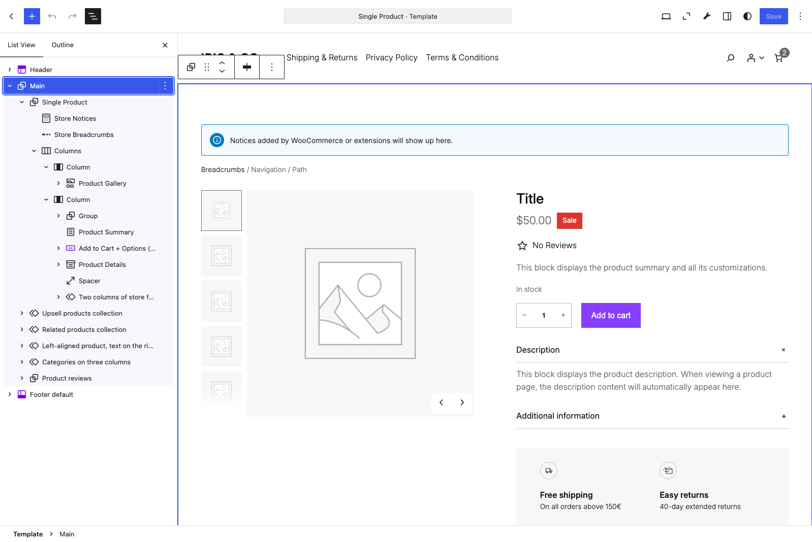

# Product page theming

WooCommerce's Single Product template is what a shopper will spend the most time viewing before they decide to buy. It's built from three overlapping layers: the classic PHP template, a Block-based compatibility layer that preserves the classic template's action hooks, and the fully Blockified template that default Block themes use.

This guide covers Blockified templates. It builds on the [Template hierarchy reference](/docs/theming/block-theme-development/template-hierarchy/) and [Global styles for WooCommerce](/docs/theming/block-theme-development/global-styles/), so if template overrides or `theme.json` styling are unfamiliar concepts, start with those first.

## Requirements

Before you begin, make sure you have the following in place:

- **A Block theme.** Every Block discussed here renders on the Blockified Single Product template, which only Block themes use by default.
- **Familiarity with the [Template hierarchy reference](/docs/theming/block-theme-development/template-hierarchy/).** You should understand how `single-product.html` resolves and how theme overrides take priority.
- **Familiarity with the Site Editor's List View and Code editor.** Several examples in this guide need you to inspect Block markup directly rather than relying on what's visible in the canvas.
- **Knowledge of Global styles for WooCommerce.** You use `theme.json` to style Blocks, so understanding this aspect is vital.
- **An understanding of your catalog's product types.** Simple, variable, grouped, and external products each render a different add-to-cart form.

## Anatomy of the Single Product template

Locating `single-product.html` can be confusing, since WooCommerce's own classic template file is called `single-product.php`. The `.html` file is a Block Template that resolves through the template hierarchy. WooCommerce ships two versions:

- A plain version that hands the page over to a classic PHP template.
- The Blockified `single-product.html` covered here.

WooCommerce chooses the correct template and a theme can override it with its own copy stored under the `/templates` folder. It's also editable through the Site Editor:



:::tip
Open **Templates \> Single Product** within the Site Editor and check for a single `woocommerce/legacy-template` Block. This means WooCommerce is using the classic PHP template. The Blockified versions use Blocks such as `woocommerce/product-image-gallery` and `woocommerce/add-to-cart-form`.
:::

The markup wraps the page in the site's shared header and footer template parts, then renders a breadcrumb trail and store notices above the two-column layout:

```html
<!-- wp:template-part {"slug":"header"} /-->

<!-- wp:group {"tagName":"main","layout":{"inherit":true,"type":"constrained"}} -->
<main class="wp-block-group">
	<!-- wp:woocommerce/breadcrumbs /-->
	<!-- wp:woocommerce/store-notices /-->

	<!-- wp:columns {"align":"wide"} -->
	<div class="wp-block-columns alignwide">
		<!-- wp:column {"width":"512px"} -->
		<div class="wp-block-column" style="flex-basis:512px">
			<!-- wp:woocommerce/product-image-gallery /-->
		</div>
		<!-- /wp:column -->

		<!-- wp:column -->
		<div class="wp-block-column">
				<!-- wp:post-title {"level": 1, "__woocommerceNamespace":"woocommerce/product-title"} /-->

				<!-- wp:woocommerce/product-rating /-->

				<!-- wp:woocommerce/product-price {"fontSize":"large"} /-->

				<!-- wp:post-excerpt {"__woocommerceNamespace":"woocommerce/product-summary", "excerptLength":100} /-->

			<!-- wp:woocommerce/add-to-cart-form /-->

			<!-- wp:woocommerce/product-meta -->
			<div class="wp-block-woocommerce-product-meta">
				<!-- wp:group {"layout":{"type":"flex","flexWrap":"nowrap"}} -->
				<div class="wp-block-group">
					<!-- wp:woocommerce/product-sku /-->

					<!-- wp:post-terms {"term":"product_cat","prefix":"Category: "} /-->

					<!-- wp:post-terms {"term":"product_tag","prefix":"Tags: "} /-->
				</div>
				<!-- /wp:group -->
			</div>
			<!-- /wp:woocommerce/product-meta -->
		</div>
		<!-- /wp:column -->
	</div>
	<!-- /wp:columns -->

	<!-- wp:woocommerce/product-details {"align":"wide","className":"is-style-minimal"} /-->

	<!-- wp:pattern {"slug":"woocommerce-blocks/related-products"} /-->
</main>
<!-- /wp:group -->

<!-- wp:template-part {"slug":"footer"} /-->
```

Everything inside the main Group is specific to the Single Product template. The header and footer template parts are shared across every other template your theme registers. However, this guide only concerns itself with what's inside main.

## The Blocks that build the page

Alongside a few single Blocks, the template's primary Blocks fall into three groups: a gallery, an add-to-cart area, and the Product Details Block. This last one covers a product's description, attributes, and reviews.

WooCommerce Blocks preserve a defined set of classic PHP action hooks by anchoring them to specific Blocks. This helps many hook-based extensions continue to work on a Block theme, but only where WooCommerce maps the extension's hook to an available Block anchor.

Regardless, each of these has quirks that you'll need to understand before you start moving things around.

:::tip
Every `block.json` referenced throughout this guide lives in `wp-content/plugins/woocommerce/client/blocks/assets/js/`. It's split between single-purpose display Blocks at `blocks/product-elements-blocks/{name}/block.json` and container Blocks at `blocks/{name}/block.json`.
:::

### Choosing a gallery Block

The default template uses `woocommerce/product-image-gallery`, a single Block with no visible child Blocks. Unlike a typical Block settings panel, this has no image size, product link, or sale badge controls. Instead, it wraps around WooCommerce's classic PHP gallery functions. It's the same compatibility layer found in the Product Details Block.

However, there's a second, richer gallery Block: `woocommerce/product-gallery`. It consists of two child Blocks: thumbnails, and a large image viewer that contains the product image, sale badge, and next/previous controls.

You'll see this version if you use the Single Product Block to embed a product elsewhere on the site rather than on the Single Product template itself:

```html
<!-- wp:woocommerce/product-gallery -->
<div class="wp-block-woocommerce-product-gallery wc-block-product-gallery">
	<!-- wp:woocommerce/product-gallery-thumbnails /-->
	<!-- wp:woocommerce/product-gallery-large-image -->
	<div class="wp-block-woocommerce-product-gallery-large-image wc-block-product-gallery-large-image__inner-blocks">
		<!-- wp:woocommerce/product-image {"showProductLink":false,"showSaleBadge":false} /-->
		<!-- wp:woocommerce/product-sale-badge {"align":"right"} /-->
		<!-- wp:woocommerce/product-gallery-large-image-next-previous /-->
	</div>

	<!-- /wp:woocommerce/product-gallery-large-image -->
</div>
<!-- /wp:woocommerce/product-gallery -->
```

If your theme's Single Product template only shows the simpler gallery and you want thumbnails and a large-image viewer instead, note that `product-gallery` restricts its `ancestor` within `block.json` to `woocommerce/single-product`. As such, the Block inserter won't offer it to you.

### Two ways to add to cart

Two different Blocks handle adding a product to the cart. `woocommerce/add-to-cart-form` renders a single form that adapts internally to the product type. It's a simpler starting point as it uses a `quantitySelectorStyle` attribute to switch between a text input and a stepper. Here, the Block uses the same per-product action hooks (and compatibility pattern) WooCommerce employs elsewhere, rather than use independent markup.

`woocommerce/add-to-cart-with-options` is newer and replaces the single form with a container that renders a different template part depending on the product type: simple, variable, grouped, or external.

:::tip
A wrapper Block's markup is always empty. The editable markup for each product type is in separate files:

- `wp-content/plugins/woocommerce/templates/parts/simple-product-add-to-cart-with-options.html`
- `wp-content/plugins/woocommerce/templates/parts/variable-product-add-to-cart-with-options.html`
- `wp-content/plugins/woocommerce/templates/parts/grouped-product-add-to-cart-with-options.html`
- `wp-content/plugins/woocommerce/templates/parts/external-product-add-to-cart-with-options.html`

To customize a layout, you'll need to override the relevant file in your theme's `/parts` folder.
:::

WooCommerce generates a template part reference for each registered product type without filtering by your current catalog. This is typically the four built-in types plus any extra you register. WooCommerce only provides template part files for the four core types, so a third-party type must provide a valid template part file path through the experimental `__experimental_woocommerce_{product_type}_add_to_cart_with_options_block_template_part` filter. A matching file in the theme's `/parts` folder can then override that registered template part, but it cannot enable the product type by itself. Without a valid filter-provided path, the Block has no add-to-cart template to render for that product type.

For example, a variable product's part builds its attribute selector from `add-to-cart-with-options-variation-selector` and its child Blocks, then adds a quantity selector and the Add to Cart Block underneath:

```html
<!-- wp:woocommerce/add-to-cart-with-options-variation-selector -->
<div class="wp-block-woocommerce-add-to-cart-with-options-variation-selector" role="list">
	<!-- wp:woocommerce/add-to-cart-with-options-variation-selector-attribute -->
	<div class="wp-block-woocommerce-add-to-cart-with-options-variation-selector-attribute" role="listitem">
		<!-- wp:group {"style":{"spacing":{"blockGap":"0.5rem","margin":{"top":"1rem","bottom":"1rem"}}},"layout":{"type":"flex","orientation":"vertical","flexWrap":"nowrap"}} -->
		<div class="wp-block-group" style="margin-top: 1rem; margin-bottom: 1rem">
			<!-- wp:woocommerce/add-to-cart-with-options-variation-selector-attribute-name /-->
			<!-- wp:woocommerce/product-filter-chips -->
			<div class="wp-block-woocommerce-product-filter-chips wc-block-product-filter-chips"></div>
			<!-- /wp:woocommerce/product-filter-chips -->
		</div>
		<!-- /wp:group -->
	</div>
	<!-- /wp:woocommerce/add-to-cart-with-options-variation-selector-attribute -->
</div>
<!-- /wp:woocommerce/add-to-cart-with-options-variation-selector -->

<!-- wp:woocommerce/add-to-cart-with-options-variation-description {"style":{"spacing":{"margin":{"top":"1rem","bottom":"1rem"}}}} /-->

<!-- wp:woocommerce/product-stock-indicator {"style":{"spacing":{"margin":{"top":"1rem","bottom":"1rem"}}}} /-->

<!-- wp:group {"layout":{"type":"flex","flexWrap":"wrap","verticalAlignment":"stretch"}} -->
<div class="wp-block-group">
	<!-- wp:woocommerce/add-to-cart-with-options-quantity-selector {"quantitySelectorStyle":"stepper"} /-->
	<!-- wp:woocommerce/product-button {"textAlign":"left"} /-->
</div>
<!-- /wp:group -->
```

Because each product type gets its own file under a theme's `/parts` folder, you can override one product type's add-to-cart layout without touching the others. For instance, a grouped product needs a very different layout. Each child product renders a quantity input, checkbox, or Add to Cart button. This is decided on a per-item basis depending on whether the child product is sold individually, is out of stock, or has options.

This is handled by giving each type a separate template part rather than one form with conditional logic inside it.

### The Product Details Block: not as empty as it looks

`woocommerce/product-details` can look empty as its `block.json` declares only an `align` and a `hideTabTitle` attribute with no default child Blocks of its own:

```html
<!-- wp:woocommerce/product-details {"className":"is-style-minimal"} -->
<div class="wp-block-woocommerce-product-details alignwide is-style-minimal"></div>
<!-- /wp:woocommerce/product-details -->
```

On the front end, this renders WooCommerce's Description, Additional information, and Reviews tabs. This is a compatibility fallback: when the Block has no inner Blocks, it renders the same tab markup WooCommerce generates on a singular product page.

To get an editable, Blockified version of the same three tabs, add `core/accordion` (or `woocommerce/accordion-group`) inside the Product Details Block, then place them as accordion items:

- `woocommerce/product-description` displays the product's full description.
- `woocommerce/product-specifications` shows the weight, dimensions, and attributes, with `showAttributes`, `showDimensions`, and `showWeight` attributes to control which appear.
- `woocommerce/product-reviews` gives you the review list, along with its own child Blocks for the review's form, author name, rating, date, and pagination.

WooCommerce also auto-detects non-default tabs returned through the `woocommerce_product_tabs` filter, regardless of whether a plugin, theme, or another customization added them. If you'd rather turn this off, you can use the `woocommerce_disable_compatibility_layer` filter.

:::note
Some Blocks have permanently empty wrapper markup (such as `woocommerce/add-to-cart-with-options`). For those Blocks, content will be generated at render time based on the template files.
:::

## Rearranging the page layout without breaking it

Swapping which template part renders for a given product type is one way of rearranging your page layout. There are also two more:

- Restructuring the shared `single-product.html` template that every product uses.
- Overriding the layout for one specific product.

Of course, each has its own mechanics and its own limitations to contend with.

### Moving Blocks: context over position

The data for Product Blocks on a Single Product template doesn't rely on its position in the markup. For example, moving the Product Price Block out of its column (or out of the two-column layout entirely) still renders the correct price. This is because the data comes from the template's product context (the `postId` the template is rendering), not from its position in the DOM.

The limitation is that several product Blocks declare an `ancestor` restriction in `block.json`, which controls the Block inserter's placement options. For instance, `woocommerce/product-button` restricts its `ancestor` to `woocommerce/all-products`, `woocommerce/single-product`, `core/post-template`, and `woocommerce/product-template`.

In practice, this means the inserter won't offer you the Add to Cart Button as a top-level Block dropped directly onto an arbitrary template; it expects one of the nearby container Blocks. This is separate from the `postId` context:

- `ancestor` gates where a Block can be inserted and checks against the Block's actual parents in the tree.
- `usesContext` (typically `postId`, `query`, and `queryId`) determines what data a placed Block renders, which is resolved from the template or Query Loop it sits inside.

However, while the Site Editor's **List View** will show you the Block tree, it doesn't flag which Blocks have contextual ties. The solution is to preview the front end rather than hoping the editor will catch it.

### What removing a Block can break

The compatibility layer means some Blocks are doing more under the hood, so removing them has consequences. WooCommerce's classic template fires a sequence of hooks around the product summary, all attached to the `woocommerce_single_product_summary` action:

| Hook | Priority | Output |
| :---: | :---: | :---: |
| `woocommerce_template_single_title` | 5 | Product title |
| `woocommerce_template_single_rating` | 10 | Star rating |
| `woocommerce_template_single_price` | 10 | Price |
| `woocommerce_template_single_excerpt` | 20 | Short description |
| `woocommerce_template_single_add_to_cart` | 30 | Add-to-Cart form |
| `woocommerce_template_single_meta` | 40 | SKU, categories, tags |
| `woocommerce_template_single_sharing` | 50 | Sharing integrations |

On the Blockified template, the `woocommerce_single_product_summary` action is wired to the `core/post-excerpt` Block rendering the short description. Any extension that still adds content through this hook is anchoring itself to that Block. In practice, you'll use this for elements such as trust badges and upsell prompts.

The compatibility layer handles sharing separately. It removes `woocommerce_template_single_sharing` from the summary action and injects the underlying `woocommerce_share` action before Product Details. Removing the short-description Block doesn't remove sharing output, but removing Product Details can.

Also, Product Details only calls WordPress' `the_post()` function while rendering its legacy fallback tabs. Once you make it Blockified, this call disappears. Related Products' underlying `woocommerce/product-template` Block calls `the_post()` for each product in the loop, then `wp_reset_postdata()`. This restores global `$product` to the product being viewed, independent of the state of Product Details.

:::tip
Before removing the short-description Post Excerpt, Product Details, or Related Products Blocks from a live template, test the change against whatever extensions your store runs. An empty layout slot isn't always a visual change.
:::

### Going narrower: overriding one product

The broadest scope of rearrangement applies to every product, but only one has the narrowest. On the Single Product template, this means a file named `single-product-{slug}.html` in your theme's `/templates` folder takes priority over `single-product.html` whenever you view the product. The others continue to fall back to the general template.

This would suit a flagship or seasonal product that needs a layout the rest of your catalog doesn't, while not duplicating the logic in PHP or maintaining a separate page template. Here, you can copy your theme's existing `single-product.html`, rename it to match the product's slug, and adjust:

```text
your-theme/
└── templates/
    ├── single-product.html
    └── single-product-limited-edition-hoodie.html
```

WordPress resolves this based on the product being viewed and the same ancestor and compatibility-layer considerations also apply to a per-product override.

## Styling product Blocks with `theme.json`

The [Global styles guide](/docs/theming/block-theme-development/global-styles/) covers the general system for styling WooCommerce Blocks through `theme.json`. However, before you rely on that system, there are some specifics with the product page Blocks to understand.

### Where a style will apply

Several product Blocks declare a top-level `selectors` object in `block.json`. Its `root` property tells WordPress where to apply `theme.json` styles instead of assuming the Block's outer wrapper element.

```jsonc
// woocommerce/product-image
"selectors": {
  "root": ".wp-block-woocommerce-product-image.wc-block-components-product-image, .wp-block-woocommerce-product-image .wc-block-components-product-image"
}

// woocommerce/product-rating
"selectors": {
  "root": ".wp-block-woocommerce-product-rating.wc-block-components-product-rating, .wp-block-woocommerce-product-rating .wc-block-components-product-rating"
}

// woocommerce/product-price
"selectors": {
  "root": ".wp-block-woocommerce-product-price .wc-block-components-product-price"
}
```

These selectors can target the wrapper, a nested element, or both. In practice, styling a Block in `theme.json` doesn't always mean styling the wrapper element. If a color or typography change through `styles.blocks.woocommerce/product-price` doesn't appear where you expect it in the rendered markup, check the Block's registered `selectors.root` value to see which element receives the styles.

:::tip
Remember: a Block's registered selectors aren't visible from the Site Editor. Make sure to check the Block's `block.json` in the WooCommerce source, or inspect the generated global styles `<style>` tag in your browser's DevTools first.
:::

### Partial support isn't full support

A Block's `supports` object tells you which style categories `theme.json` can touch for the Block, with various support on offer per-Block. For example, `woocommerce/product-button` declares border support for radius only, so it does not expose border color, width, or style through `theme.json`. In contrast, `woocommerce/product-image` supports border color, width, style, and radius.

If a design calls for a colored border around the Product Button, this is a [job for CSS](https://developer.woocommerce.com/docs/theming/block-theme-development/css-styling/) rather than `theme.json`.

This same principle applies to color: `woocommerce/product-rating` supports text color but not background or link color:

```json
{
  "styles": {
    "blocks": {
      "woocommerce/product-rating": {
        "color": {
          "text": "var(--wp--preset--color--accent-1)"
        }
      }
    }
  }
}
```

### Styling Fill and Outline directly

`woocommerce/product-button` registers two **Fill** and **Outline** Block styles. Both are standard Block style variations that `theme.json` can style independently using a scoped `variations` property based on what supported properties you need:

```json
{
  "styles": {
    "blocks": {
      "woocommerce/product-button": {
        "color": {
          "text": "var(--wp--preset--color--base)",
          "background": "var(--wp--preset--color--contrast)"
        },
        "variations": {
          "outline": {
            "color": {
              "text": "var(--wp--preset--color--contrast)"
            }
          }
        }
      }
    }
  }
}
```

Because border color isn't part of this Block's supported style properties, the **Outline** style's border rendering comes from the Block's bundled stylesheet. So, `theme.json` can shift the text and background colors used within each variation, but not the border itself.

## Practical customization examples

There are a few typical tasks for the Single Product template that can stay fully within the Block system rather than reaching for PHP. This lets you edit through the Site Editor rather than tie it to a theme's code.

### Building the Blockified Product Details tabs

This is a good example of a Blockified version showing the compatibility layer's fallback behavior explained earlier:

```html
<!-- wp:woocommerce/product-details {"align":"wide"} -->
<div class="wp-block-woocommerce-product-details alignwide">
	<!-- wp:accordion -->
	<div class="wp-block-accordion" role="group">
		<!-- wp:accordion-item -->
		<div class="wp-block-accordion-item">
			<!-- wp:accordion-heading {"showIcon":false} -->
			<h3 class="wp-block-accordion-heading">
				<button type="button" class="wp-block-accordion-heading__toggle">
					<span class="wp-block-accordion-heading__toggle-title">Description</span>
				</button>
			</h3>
			<!-- /wp:accordion-heading -->
			<!-- wp:accordion-panel -->
			<div class="wp-block-accordion-panel" role="region">
				<!-- wp:woocommerce/product-description /-->
			</div>
			<!-- /wp:accordion-panel -->
		</div>
		<!-- /wp:accordion-item -->
	</div>
	<!-- /wp:accordion -->
</div>
<!-- /wp:woocommerce/product-details -->
```

Non-default tabs returned through the `woocommerce_product_tabs` filter are automatically injected by WooCommerce. The default Specifications and Reviews tabs aren't, so you'll need to repeat the pattern for `woocommerce/product-specifications` and `woocommerce/product-reviews`.

### Replacing Related Products with a curated pick

The default Related Products pattern queries by shared categories and tags, which isn't always the right fit where you need specific product pairings, such as an accessory that goes only with one product. Swapping in a hand-picked query means changing layout and sizing attributes as well as the query attributes:

```html
<!-- wp:woocommerce/product-collection {"queryId":0,"query":{"perPage":4,"pages":1,"postType":"product","inherit":false,"isProductCollectionBlock":true,"woocommerceHandPickedProducts":["154","289","310","422"]},"collection":"woocommerce/product-collection/hand-picked","displayLayout":{"type":"flex","columns":4,"shrinkColumns":true},"dimensions":{"widthType":"fill"}} -->
<div class="wp-block-woocommerce-product-collection">
	<!-- wp:heading {"textAlign":"center","level":2,"style":{"spacing":{"margin":{"bottom":"1rem"}}}} -->
	<h2 class="wp-block-heading has-text-align-center">You may also like</h2>
	<!-- /wp:heading -->

	<!-- wp:woocommerce/product-template -->
		<!-- wp:woocommerce/product-image {"showSaleBadge":false,"style":{"dimensions":{"aspectRatio":"1/1"}}} -->
		<div class="wp-block-woocommerce-product-image">
			<!-- wp:woocommerce/product-sale-badge {"align":"right"} /-->
		</div>
		<!-- /wp:woocommerce/product-image -->

		<!-- wp:post-title {"textAlign":"center","level":2,"fontSize":"medium","style":{"spacing":{"margin":{"bottom":"0.75rem","top":"0"}},"typography":{"lineHeight":"1.4"}},"isLink":true,"__woocommerceNamespace":"woocommerce/product-title"} /-->

		<!-- wp:woocommerce/product-price {"textAlign":"center","fontSize":"small"} /-->

		<!-- wp:woocommerce/product-button {"textAlign":"center","fontSize":"small"} /-->
	<!-- /wp:woocommerce/product-template -->
</div>
<!-- /wp:woocommerce/product-collection -->
```

You can replace this in place of the `woocommerce-blocks/related-products` pattern in your template override, then update the product IDs in `woocommerceHandPickedProducts` if the pairing needs to differ across your catalog.
