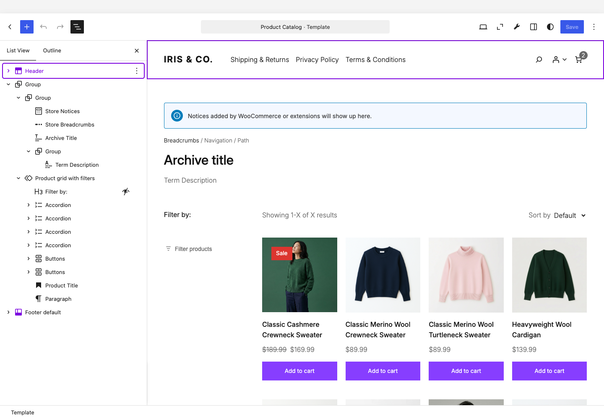
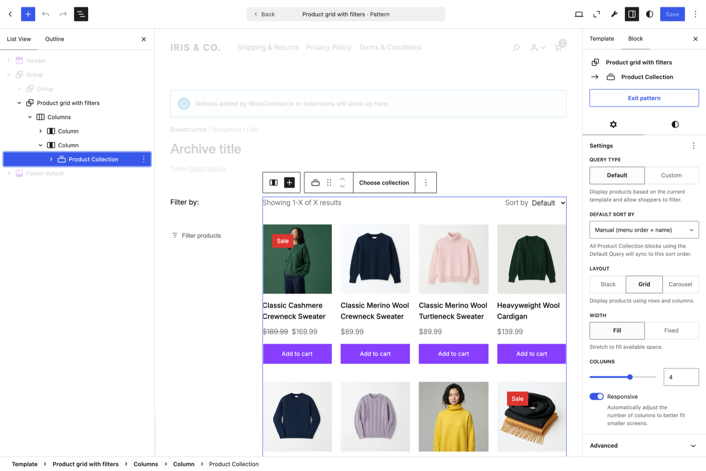
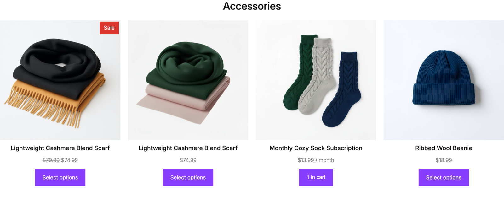
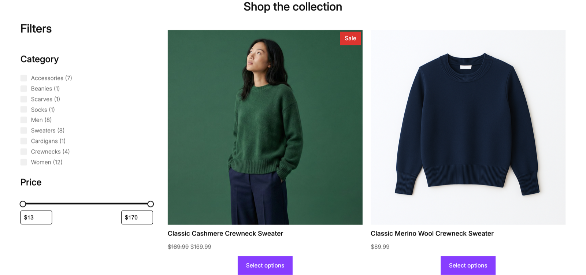
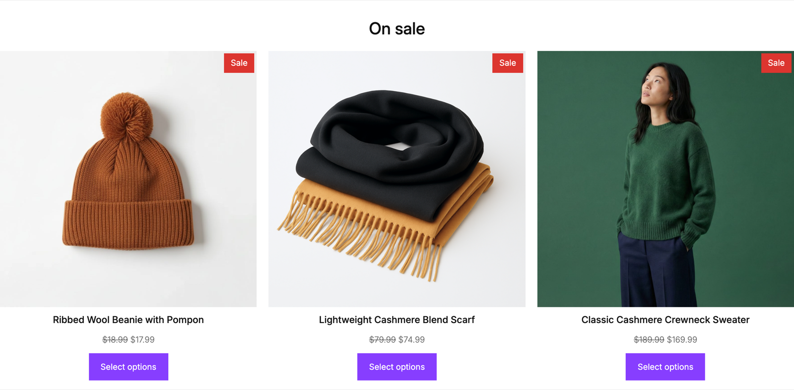

# Shop and archive page theming

The Product Catalog template will be one of the first interactions when browsing a WooCommerce site. This involves browsing a grid built from the Product Collection Block, which WooCommerce reuses across every product listing on the store.

This guide walks through the Product Catalog template to show you its structure, the grid and its layout choices, sorting and filtering, pagination, how a theme customizes an individual category or tag, and more. It builds on the [Template hierarchy reference](/docs/theming/block-theme-development/template-hierarchy/) and [Global styles for WooCommerce](/docs/theming/block-theme-development/global-styles/), so if template fallbacks or `theme.json` styling are unfamiliar concepts, start with those first. Where a Block also appears on the Single Product template, [Product page theming](/docs/theming/block-theme-development/product-page-theming/) covers styling options for it in more depth than this guide repeats.

## Requirements

Before you begin, make sure you have the following in place:

- **A Block theme.** Every Block discussed here renders on the Blockified Product Catalog template, which only Block themes use by default.
- **Familiarity with the Template hierarchy reference.** You should understand how `archive-product.html` resolves and how the taxonomy templates fall back to it.
- **Familiarity with Global styles for WooCommerce.** Several Blocks on this template style through `theme.json`.
- **Familiarity with the Site Editor's List View and Code editor.** Several examples in this guide need you to inspect Block markup directly.

## How the template is put together

WooCommerce's own classic template for this page is `archive-product.php`, so the Block Template shares the same `archive-product.html` name. It resolves through the same template hierarchy as any other page type.

WooCommerce ships a default `archive-product.html` inside its own plugin folder, which a Block theme falls back to unless the theme provides its own copy at the same path:



```html
<!-- wp:template-part {"slug":"header"} /-->

<!-- wp:group {"tagName":"main","layout":{"inherit":true,"type":"constrained"}} -->
<main class="wp-block-group">
	<!-- wp:woocommerce/breadcrumbs /-->
	<!-- wp:query-title {"type":"archive","showPrefix":false,"align":"wide"} /-->
	<!-- wp:term-description {"align":"wide"} /-->
	<!-- wp:woocommerce/store-notices /-->

	<!-- wp:group {"layout":{"type":"flex","flexWrap":"nowrap","justifyContent":"space-between"}} -->
	<div class="wp-block-group alignwide">
		<!-- wp:woocommerce/product-results-count /-->
		<!-- wp:woocommerce/catalog-sorting /-->
	</div>
	<!-- /wp:group -->

	<!-- wp:woocommerce/product-collection {"queryId":0,"query":{"inherit":true,"isProductCollectionBlock":true},"displayLayout":{"type":"flex","columns":3,"shrinkColumns":true},"align":"wide"} -->
	<div class="wp-block-woocommerce-product-collection alignwide">
		<!-- wp:woocommerce/product-template -->
		<!-- wp:woocommerce/product-image {"showSaleBadge":false,"imageSizing":"thumbnail"} -->
			<!-- wp:woocommerce/product-sale-badge {"align":"right"} /-->
		<!-- /wp:woocommerce/product-image -->
		<!-- wp:post-title {"textAlign":"center","level":2,"isLink":true,"fontSize":"medium","__woocommerceNamespace":"woocommerce/product-title","style":{"typography":{"lineHeight":"1.4"}}} /-->
		<!-- wp:woocommerce/product-price {"textAlign":"center","fontSize":"small","style":{"spacing":{"margin":{"bottom":"1rem"}}}} /-->
		<!-- wp:woocommerce/product-button {"textAlign":"center","fontSize":"small","style":{"spacing":{"margin":{"bottom":"1rem"}}}} /-->
		<!-- /wp:woocommerce/product-template -->

		<!-- wp:query-pagination {"layout":{"type":"flex","justifyContent":"center"}} -->
		<!-- wp:query-pagination-previous /-->
		<!-- wp:query-pagination-numbers /-->
		<!-- wp:query-pagination-next /-->
		<!-- /wp:query-pagination -->

		<!-- wp:woocommerce/product-collection-no-results -->
		<!-- wp:group {"layout":{"type":"flex","orientation":"vertical","justifyContent":"center","flexWrap":"wrap"}} -->
		<div class="wp-block-group">
			<!-- wp:pattern {"slug":"woocommerce/no-products-found-clear-filters"} /-->
		</div>
		<!-- /wp:group -->
		<!-- /wp:woocommerce/product-collection-no-results -->
	</div>
	<!-- /wp:woocommerce/product-collection -->
</main>
<!-- /wp:group -->

<!-- wp:template-part {"slug":"footer"} /-->
```

Both `core/query-title` and `core/term-description` are core WordPress Blocks. WooCommerce configures both for the product context, but styling and behavior for either follows core WordPress conventions rather than anything WooCommerce-specific.

As the Template hierarchy reference covers, `archive-product.html` is the fallback for every taxonomy archive: Products by Category, Products by Tag, Products by Attribute, and Products by Brand. However, two cases are worth calling out.

First, **Products by Attribute** uses `archive-product.html` by default. A theme template named `taxonomy-product_attribute.html`, or a customized database template with that slug, takes priority when present. To give attribute archives a separate design, add `taxonomy-product_attribute.html` to your theme.

Also, **Product Search Results** (`product-search-results.html`) swaps the query title's `type` to `search` and renders two separate patterns in its no-results state: `woocommerce/no-products-found` and `woocommerce/product-search-form`. Typically, a shopper landing here has already tried to find something specific, so the separate search form is a nice UX addition.

## The product grid: Blocks and layout choices

`woocommerce/product-collection` is the Block behind every product grid on the storefront. On a taxonomy or search template, the `query.inherit` attribute set to `true` tells the Block to read its product set from the current request rather than a fixed list. This is what makes one Block definition work correctly regardless of what a shopper is viewing.



The Block offers three layout options in its sidebar settings:

- **Grid** renders a configurable number of columns, with a Responsive toggle that lets columns shrink on narrower viewports. This is the default for the Product Catalog template and every taxonomy archive that falls back to it.
- **Stack** renders products in a single vertical list rather than a grid, which is the closest thing this Block has to a dedicated list view.
- **Carousel** renders a horizontal slider, which is better suited to a featured strip on a landing page than a full catalog listing.

Inside the Block, `woocommerce/product-template` wraps repeating markup for each product. It accepts color and typography through `theme.json`, even though the Product Collection Block itself doesn't. As such, it's a reasonable place to set shared styles across every card without repeating the rule on each child Block.

### Choosing to style in `theme.json`

The default catalog card sticks to only a few Blocks:

- **Product Image** renders the featured image and (for this template) links through to the single product.
- **Product Sale Badge**, nested in Product Image, displays once a product has a sale price.
- **Product Title**, rendered through `core/post-title` in this context rather than a dedicated WooCommerce Block, links to the same product page.
- **Product Price** shows both the current price and any sale price.
- **Add to Cart Button** adds a product to the cart or links to the product page. Simple products add-to-cart from the card. Other product types send the visitor to the product page.

:::tip
Product page theming covers these Blocks in more depth, since they also appear in the Single Product template's summary area. This includes registered selectors and any supported style properties.
:::

The Product Collection Block does not register spacing support, and the gap between product cards comes from the inner `.wc-block-product-template` grid. To change that gap, use a Block stylesheet rather than `theme.json`:

```css
.wc-block-product-template.is-flex-container,
.wc-block-product-template__responsive {
  gap: 2rem;
}
```

A shared text color or font across every card still styles through `theme.json` like any other Block:

```json
{
  "styles": {
    "blocks": {
      "woocommerce/product-template": {
        "typography": {
          "fontFamily": "var(--wp--preset--font-family--body)"
        }
      }
    }
  }
}
```

You can extend this to any of the other Blocks through targeting a registered Block name instead.

## Sorting and filtering the catalog

Your main concerns will be how many results a shopper is looking at and which order those results appear in. The subset of the catalog they're seeing is also important.

WooCommerce splits these across three Blocks, two of which ship in the default template and one you add yourself. However, all can update the grid without a full page reload.

### Counting and sorting results

`woocommerce/product-results-count` and `woocommerce/catalog-sorting` each render through a classic WooCommerce function server-side, then layer Interactivity API behavior on top.

**Product Results Count**'s render callback calls `woocommerce_result_count()`, which loads the overridable `loop/result-count.php` template. Copying this file into a theme's `woocommerce/loop/` directory still changes the text this Block displays, exactly as it would on a classic theme.

The count itself follows the product grid settings (the `woocommerce_catalog_columns` and `woocommerce_catalog_rows` options). Because Block themes don't have a Customizer, you can use the `loop_shop_per_page` filter as an override.

**Catalog Sorting**'s render callback calls `woocommerce_catalog_ordering()`, which builds the drop-down menu from the `woocommerce_catalog_orderby` filter and reads its default selection from the `woocommerce_default_catalog_orderby` filter or option. The base option set contains `menu_order`, `popularity`, `rating`, `date`, `price`, and `price-desc`. Search pages add `relevance` and remove `menu_order`. WooCommerce also removes `menu_order` on other catalog pages when it isn't the configured default, and removes `rating` on every page when product ratings are disabled.

A plugin that already customizes the sorting drop-down menu on a classic theme needs no changes to keep working:

```php
add_filter( 'woocommerce_catalog_orderby', function( $options ) {
	unset( $options['rating'] );
	return $options;
} );
```

However, the Blockified template will differ depending on what happens after you generate the PHP output. WooCommerce runs the rendered form through `WP_HTML_Tag_Processor` to add `data-wp-interactive`, `data-wp-on--submit`, and `data-wp-on--change` attributes. The form connects to the Interactivity API, so a sorting change updates the grid instead of submitting the form and reloading the page.

The Sorting Block also exposes a `useLabel` attribute that toggles the **Sort by** text alongside the drop-down menu. Both Blocks support text color and font size through `theme.json`, as per the Global styles guide.

Neither Block depends on the other for placement. The default template puts them in a flex Group sitting on the same row, but you can separate them, hide one, or move both elsewhere in the layout without affecting how either one queries or renders its data.

### Adding the Product Filters Block

:::note
Several child filter Blocks save as an empty wrapper div and populate through the Interactivity API once the page loads. See WordPress' [Interactivity API reference guide](https://developer.wordpress.org/block-editor/reference-guides/interactivity-api/) or the WooCommerce post on [rendering interactive Blocks](https://developer.woocommerce.com/2025/10/30/understanding-the-interactivity-api-driven-future-for-woocommerce-blocks/) for more details.
:::

The Product Filters Block is not part of the default catalog template. On an inherited archive query, it can sit beside the Product Collection Block because WooCommerce connects it to the active catalog query. For a custom or non-inherited collection, nest Product Filters inside Product Collection so it receives that collection's query context.

```html
<!-- wp:woocommerce/product-filters -->
<div class="wp-block-woocommerce-product-filters">
	<!-- wp:woocommerce/product-filter-price -->
		<div class="wp-block-woocommerce-product-filter-price">
			<!-- wp:heading {"level":3} --><h3 class="wp-block-heading">Price</h3><!-- /wp:heading -->
			<!-- wp:woocommerce/product-filter-price-slider -->
			<div class="wp-block-woocommerce-product-filter-price-slider"></div>
			<!-- /wp:woocommerce/product-filter-price-slider -->
		</div>
	<!-- /wp:woocommerce/product-filter-price -->

	<!-- wp:woocommerce/product-filter-attribute {"attributeId":1} -->
		…
		<!-- /wp:woocommerce/product-filter-attribute -->

	<!-- wp:woocommerce/product-filter-active -->
	…
	<!-- /wp:woocommerce/product-filter-active -->
</div>
<!-- /wp:woocommerce/product-filters -->
```

Each filter type is its own child Block, so you only add the ones a design calls for:

| Filter Block | Filters by |
| :---- | :---- |
| Price Filter | A minimum and maximum price, shown as a slider with optional input fields. |
| Attribute Filter | A single chosen attribute, such as color or size, as a list or as chips. |
| Rating Filter | Customer rating. Only appears once at least one product carries a rating. |
| Availability Filter | Stock status: in stock, out of stock, or on backorder. |
| Taxonomy Filter | A taxonomy you choose when adding the Block: category, tag, or brand. |
| Active Filters | Every filter currently applied, as removable chips. |

Every filter type shares one Block `ancestor` restriction: each expects to sit inside `woocommerce/product-filters`, which is why the inserter won't offer the Price Filter Block as a top-level addition to an arbitrary template. This mirrors the `ancestor` restrictions for general product page theming.

### Configuring the behavior of filters

The Product Filters Block's **Overlay** setting controls whether filters remain on the page or open in an overlay. Its options are **Off**, **Mobile**, and **Always**, stored in the `overlayMode` attribute. When an overlay is enabled, **Overlay position** sets `overlayPosition` to the left or right. **Reload full page** is found in the Product Collection Block's Advanced settings and sets an attribute called `forcePageReload`, which is disabled by default.

When `forcePageReload` is `false`, WooCommerce gives the Product Collection Block its own `data-wp-router-region` attribute, and Product Filters renders a separate router region. Both can use the WordPress Interactivity API's client-side navigation. Setting `forcePageReload` to `true` disables enhanced pagination and tells nested Product Filters to reload through Block context. For an inherited archive query where Product Filters is a sibling, WooCommerce provides the same value through `wp_interactivity_config()`. Reach for it if another Block or customization inside the collection depends on a traditional full-page reload.

Product Filters declares the following context keys. When nested in a custom Product Collection, it receives the collection's query and `forcePageReload` setting through Block context. When it's a sibling of an inherited archive collection, it relies on the archive query and uses the global configuration described above for `forcePageReload`:

```json
"usesContext": [
  "postId",
  "query",
  "queryId",
  "collection",
  "productCollectionLocation",
  "forcePageReload"
]
```

This also checks for an `isProductCollectionBlock` attribute that's nested inside `query`. The template's own Product Collection Block already includes this, but any product collection you create will need this to ensure you don't have to reload the page to display front-end changes.

:::note
The Attribute Filter, Price Filter, and Active Filters Blocks existed before Product Filters, as `woocommerce/attribute-filter`, `woocommerce/price-filter`, and `woocommerce/active-filters`. Those predate the Product Collection Block, so they don't appear in the Blockified Product Catalog template.
:::

## Pagination

Pagination renders through the core Query Pagination Block as Product Collection registers itself as a compatible query source for it. Product Collection and Product Filters render separate router regions, although both can use client-side navigation. The `forcePageReload` attribute disables enhanced pagination for the collection and tells the associated filters to fall back to a full-page reload through the context or configuration described above.

With the default setting, moving between pages updates the grid through client-side navigation, then moves focus to the first product link in the updated collection. This focus change can also move the shopper's scroll position. Enabling **Reload full page** falls back to standard link navigation for the pagination controls instead.

The Query Pagination Block only appears once a collection spans more than one page, so testing pagination changes against a catalog with enough products matters more here than anywhere else on the template. A collection with fewer products than its Products per page setting renders no pagination Blocks. This can make a pagination override look broken in a near-empty development environment when it isn't.

The following child Blocks build the default pagination control:

- **Pagination Previous** links to the prior page and is hidden on the first page.
- **Pagination Numbers** lists individual page numbers. The `midSize` attribute sets how many links show on either side of the current page before it displays ellipses.
- **Pagination Next** links to the following page and hides on the last page similar to Pagination Previous.

Each accepts its own label text and styles through the same core Block settings you'd use for a blog's post list, rather than anything WooCommerce-specific.

If a shopper sees no matches on the page (such as a category with no products or a search with no hits), the template uses `woocommerce/product-collection-no-results`. The default catalog template points this at the `no-products-found-clear-filters` pattern.

## Customizing category, tag, and brand archives

Every taxonomy has a term-specific file that takes priority over the taxonomy's general file, which in turn falls back to `archive-product.html`. This applies identically to brands:

```text
your-theme/
└── templates/
    ├── archive-product.html
    ├── taxonomy-product_cat-outerwear.html
    └── taxonomy-product_brand-acme.html
```

This might suit a Stack instead of a Grid (where you need a different layout) or a featured banner above the results, without touching the design every other archive uses.

Here, you can copy the general taxonomy template (or `archive-product.html` if the taxonomy has no dedicated file of its own) and rename it to match the term's slug. WordPress resolves the correct file based on the term being viewed.

### What a term-level override can break

WooCommerce's classic template fires a sequence of hooks around the product loop. These are preserved on the Blockified template through an internal compatibility layer that anchors each hook to a specific Block:

| Block | Position | Hook |
| :---: | :---: | :---: |
| Product Collection | Before | `woocommerce_before_main_content` |
|  | After | `woocommerce_after_main_content` |
| Product Template | Before | `woocommerce_before_shop_loop` |
|  | After | `woocommerce_after_shop_loop` |
| Post Title | Before | `woocommerce_before_shop_loop_item_title` |
|  | After | `woocommerce_shop_loop_item_title`, `woocommerce_after_shop_loop_item_title` |
| Term Description | Before | `woocommerce_archive_description` |
| Query No Results | Before | `woocommerce_no_products_found` |
| Each product item | Before | `woocommerce_before_shop_loop_item` |
|  | After | `woocommerce_after_shop_loop_item` |

`woocommerce_before_shop_loop_item` and `woocommerce_after_shop_loop_item` anchor to each product's internal item context. It means they won't break if you remove a Block.

For example, an extension that still adds content through `woocommerce_archive_description` is anchoring itself to the Term Description Block. A term-level override that drops a Block removes the anchor too, which can leave an extension's content with nowhere to render on that one archive even though it still appears everywhere else.

:::tip
Before removing the Product Template, Post Title, Term Description, or Query No Results Blocks from a term-level override, test the change against your current extensions. A missing hook anchor isn't always a visual change you'd catch by looking at the canvas.
:::

## Common customization examples

The Blocks and settings covered so far combine into a handful of layouts that come up often. Each of the following can go directly into a template override and uses the concepts taught in this guide.

### A single row for a category landing page



A category or brand override sometimes needs a short, curated row rather than a full paginated catalog. Some attributes on the Product Collection Block can produce this without needing a second, differently-configured Block:

```html
<!-- wp:woocommerce/product-collection {
	"query": {
		"perPage": 4,
		"pages": 1,
		"inherit": false,
		"taxQuery": {
			"product_cat": [19]
		},
		"isProductCollectionBlock": true
	},
	"displayLayout": {
		"type": "flex",
		"columns": 4
	},
	"collection": "woocommerce/product-collection/by-category"
} -->

<div class="wp-block-woocommerce-product-collection">

<!-- wp:woocommerce/product-template -->
<!-- wp:woocommerce/product-image -->
<!-- wp:woocommerce/product-sale-badge /-->
<!-- /wp:woocommerce/product-image -->

<!-- wp:post-title {"isLink":true,"__woocommerceNamespace":"woocommerce/product-title"} /-->

<!-- wp:woocommerce/product-price /-->

<!-- wp:woocommerce/product-button /-->
<!-- /wp:woocommerce/product-template -->
</div>

<!-- /wp:woocommerce/product-collection -->
```

Here, `query.perPage` sets how many products load, while `query.pages` only displays a single page of results.

To restrict the products in the category from displaying, you use the following interdependent attributes:

- `taxQuery` filters by the category, for which you'll need the term ID (found as the `tag_ID` within the edit screen URL).
- `inherit: false` unlinks the query from the typical display template.
- `collection` identifies this as a built-in recipe rather than a custom query.

Finally, `isProductCollectionBlock` ties the Block to the same pagination behavior and router region described earlier. This means it typically has to nest in `query` to have any effect.

### Filters beside the grid instead of above it



The default template puts sorting above the grid, but a sidebar layout is just as valid and doesn't need any new Blocks.

For an inherited catalog archive, place Product Filters and Product Collection in separate columns as siblings. The collection's `query` defines the inheritance, while `displayLayout` sets the grid's column count:

```html
<!-- wp:columns {"align":"wide"} -->
<div class="wp-block-columns alignwide">
	<!-- wp:column {"width":"25%"} -->
	<div class="wp-block-column" style="flex-basis:25%">
		<!-- wp:woocommerce/product-filters -->…<!-- /wp:woocommerce/product-filters -->
	</div>
	<!-- /wp:column -->

	<!-- wp:column {"width":"75%"} -->
	<div class="wp-block-column" style="flex-basis:75%">
		<!-- wp:woocommerce/product-collection {"queryId":0,"query":{"inherit":true,"isProductCollectionBlock":true},"displayLayout":{"type":"flex","columns":2}} -->…<!-- /wp:woocommerce/product-collection -->
	</div>
	<!-- /wp:column -->
</div>
<!-- /wp:columns -->
```

For a custom or non-inherited Product Collection, keep Product Filters inside that collection instead so the filter receives the correct query context.

### Swapping the default catalog query for a curated collection



Product Collection's Custom query type replaces its default template-driven behavior with a fixed set of results. As an example, you could use this for a landing page built around a single promotion:

```html
<!-- wp:woocommerce/product-collection {"query":{"inherit":false,"woocommerceOnSale":true,"perPage":8,"isProductCollectionBlock":true},"displayLayout":{"type":"flex","columns":4}} -->
<div class="wp-block-woocommerce-product-collection alignwide">
	<!-- wp:heading -->
	<h2 class="wp-block-heading">On sale now</h2>
	<!-- /wp:heading -->
	<!-- wp:woocommerce/product-template -->
		<!-- wp:woocommerce/product-image /-->
		<!-- wp:post-title {"level":3,"isLink":true,"__woocommerceNamespace":"woocommerce/product-title"} /-->
		<!-- wp:woocommerce/product-price /-->
	<!-- /wp:woocommerce/product-template -->
</div>
<!-- /wp:woocommerce/product-collection -->
```

Setting `query.inherit` to `false` breaks the connection to the template or page the Block is on. Without it, you wouldn't see the fixed on-sale set of products.

`woocommerceOnSale` is one of several filter attributes the Custom query type exposes. However, unlike the example of a single row of category-based products, you don't need a matching `collection` value.
